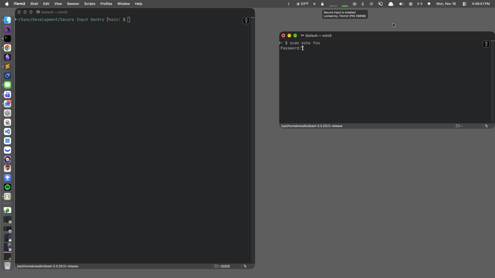

# Secure Input Sentry

### What this is

Compact menubar app that monitors for apps enabling (locking) macOS SecureInput. When locked, certain clipboard/snippet operations may fail. Notably things like clipboard/snippet managers (Alfred in my case!) or pasting from password managers. You might experience it as triggering a hotkey or snippet, but having nothing happen.

This app presents a realtime visual indicator of when this condition is present so you know what's going on, and can assist with troubleshooting.

Inspired by this bug: [macOS Secure Input not released after pressing Enter to submit login form (breaks system-wide hotkey [567613584] - Chromium](https://issues.chromium.org/issues/567613584)

More about SecureInput from Apple: [Technical Note TN2150: Using Secure Event Input Fairly](https://developer.apple.com/library/archive/technotes/tn2150/_index.html)

### Install & Use

Download the latest [release](https://github.com/luckman212/secure-input-sentry/releases), drag it into your Applications folder, and run it. The app is signed and notarized, and no special permissions are required. It's a Universal Binary and should run on Intel and AppleSilicon.

### What you'll see

Here's an example of what you'll see when the app is running and SecureInput is triggered:



### Sound Effects

Version 1.1.1 introduces sound effects (off by default) that help grab your attention when SecureInput gets triggered and released, in case the menu bar icon is too subtle. To enable the sound, run the command below (you don't need to restart the app):

```bash
defaults write com.luckman212.secureinputsentry PlaySound -bool TRUE
```

To disable it, run:

```bash
defaults write com.luckman212.secureinputsentry PlaySound -bool FALSE
```

### Run at startup

To keep the code simple, I didn't spend time bundling in automatic Startup Item registration via the normal `ServiceManagement/SMAppService`. To have the app automatically run on every login, simply drag it into your login item settings panel:


### Bugs

Yep, there might be some. Please report any issues!
